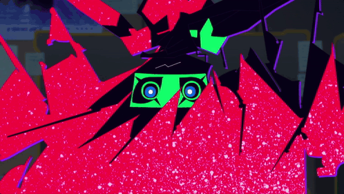

<h1 align="center">✦ Capri for Mac</h1>

<p align="center">An animated desktop companion with a playful voice and a place on your screen.</p>

<p align="center">
  
</p>

<p align="center">
  <strong>macOS 26+ · Apple silicon · Unofficial fan project</strong>
</p>

<p align="center">
  <a href="https://github.com/spiermar2/capri-for-mac/releases/latest"><strong>Download for Mac →</strong></a>
  &nbsp; · &nbsp;
  <a href="#download-and-open">Getting started</a>
  &nbsp; · &nbsp;
  <a href="#set-up-a-voice-with-elevenlabs">Voice setup</a>
  &nbsp; · &nbsp;
  <a href="#controls">Controls</a>
</p>

---

Capri hangs out as a small star until you summon her. Tap **right Command** to open her animated chat window, then tap it again to let her go dormant. Talk, type, or leave her to idle beside your work.

| Feature | What it does |
| --- | --- |
| **Star + screen** | A compact star opens into an animated portrait and chat window. |
| **Idle reactions** | Local glances, grins and gestures while Capri is waiting. No AI or voice credits used. |
| **Chat and voice** | Capri-inspired conversation, including practical answers, with your own ChatGPT account and optional streaming ElevenLabs speech. |
| **Full-body mode** | Drag Capri around, double-click to pat her, or let her perch on a window edge. |

> **Your accounts, your usage.** Each person connects their own ChatGPT account and ElevenLabs key. The app includes no shared credentials or maintainer-funded service. Your requests use your accounts' allowance or credits.

## Download and open

1. Go to [the latest release](https://github.com/spiermar2/capri-for-mac/releases/latest) and download **Capri-for-Mac-v0.5.4-arm64.zip** under **Assets**.
2. Unzip it and move **Capri for Mac.app** into **Applications**. Keep one installed copy.
3. Open Capri. Right-click her or use the menu-bar icon to reach **Settings**.

**Requires macOS 26 or later on an Apple silicon Mac. Intel Macs aren't supported.**

<details>
<summary><strong>First launch: macOS may block this app</strong></summary>

This release is **ad-hoc signed**. It is not signed with an Apple Developer ID or notarized by Apple.

If you trust the release, open **System Settings → Privacy & Security → Open Anyway** when offered, then confirm. Keep Gatekeeper enabled. [Apple's first-launch instructions](https://support.apple.com/en-us/102445)

</details>

## Connect ChatGPT

1. In **Settings → BRAIN**, select **ChatGPT · your plan**, then **ChatGPT account…**.
2. Choose **Continue with ChatGPT**, sign in to **your own account**, and review the requested access in your browser.
3. Choose an available model. **Refresh models** checks your access; **Manage usage** opens your account's usage controls.

You don't need to enter an OpenAI API key. Submitted messages and recent conversation context go to OpenAI; Capri doesn't import your other ChatGPT conversations.

<details>
<summary>Models, Fast processing and local alternatives</summary>

**GPT-6.1 Sol** is the default model preference. Availability, account eligibility and limits depend on OpenAI and your account.

Capri requests Fast processing for that model without reducing its default reasoning level. Fast delivery isn't guaranteed: the status distinguishes **Fast requested** from the processing tier the service actually reports.

You can also select **Apple Intelligence** on a compatible, enabled Mac, or an existing **Ollama** model at `127.0.0.1:11434`. Capri doesn't install models or switch to a local backend automatically after a ChatGPT error.

</details>

## Set up a voice with ElevenLabs

Create a voice you like in your own ElevenLabs account, then connect it to Capri. **Voice Design uses a text description; no recording or voice clone is needed.**

1. In ElevenLabs, open **Voices → My Voices → Add a new voice → Voice Design**. Paste the prompt below, add preview text, generate the options, and save your favorite. [Voice Design guide](https://elevenlabs.io/docs/eleven-creative/voices/voice-design)
2. In **My Voices**, open the saved voice's **More actions (…) → Copy voice ID**. [Finding your voice ID](https://elevenlabs.io/docs/help-center/technical/how-do-i-find-the-voice-id-of-my-voices-via-the-website-and-api)
3. Open **Developers → API Keys** and create your own key with **Text to Speech** access. Use only the permissions you need; you can set a credit limit. [API-key guide](https://elevenlabs.io/docs/help-center/technical/how-do-i-authorize-myself-using-an-api-key)
4. In Capri's **Settings → VOICE**, select **Capri · ElevenLabs**. Paste the key into the secure field, click **Save key**, and enter your **Voice ID**.
5. Click **Test voice**, then enable **Speak replies**.

<details>
<summary><strong>Copy the Voice Design prompt</strong></summary>

The original design prompt is preserved below. It is a creative description, not a verified description of the original performer, and doesn't guarantee the show's voice.

```text
cybernetic hologramic sounding woman playful voice is light, bright, and buoyant, with a lilt that lifts at the ends of her phrases as though she’s teasing or in on a joke only she understands. Her pacing is quick and bouncy, slipping between mock-innocent sweetness and a sly, knowing edge that keeps listeners slightly off balance. She sounds close and airy, almost whispered into the ear, which suits an AI construct who exists only inside the heads of those who plug in her chip, and a faint digital sheen, a flicker of glitch or shimmer, tends to creep in when her mischief sharpens. Beneath the performance, the act can crack, letting a quieter, more vulnerable tone slip through that hints at the Project Capricorn past she can’t quite escape. Note that this is an inference from the character’s role rather than a verified description of the actual performance, so it’s worth checking against the show itself.
```

</details>

Voice generation, saved voices and voice access depend on your ElevenLabs plan. **Test voice** and spoken replies use your ElevenLabs allowance or credits. Audio plays as it arrives, though a short synthesis delay may remain.

Prefer a built-in voice? Choose **Mac system voice**, or turn **Speak replies** off. Neither needs an ElevenLabs key. A voice ID identifies a voice; it is not a key and doesn't grant access to someone else's account.

## Controls

| Input | Action |
| --- | --- |
| **Right Command (⌘)** | Summon Capri / return to the dormant star |
| **⌥⌘C** — Option–Command–C | Alternate summon / dormant shortcut |
| **⌃⌥⌘C** — Control–Option–Command–C | Hide / restore everything, including the star |
| **Click the star** | Open the screen |
| **Escape** or **×** | Collapse the screen |
| **Drag Capri** | Move her |
| **Right-click** | Open the menu |
| **Microphone** | Dictate a draft; review it and press Return to send |

Enable **Settings → Enable shortcut… → Accessibility** to use right Command while another app is focused. **Settings → LOOK** switches between **Star + screen** and **Full-body companion**. Idle animations and window interactions have their own switches.

<details>
<summary>Shortcut or Keychain permission prompts after an update?</summary>

Replacing or rebuilding an ad-hoc signed app can require refreshing its Accessibility or Keychain approval. Check Capri's shortcut status in Settings and approve the installed copy in macOS settings when needed.

If macOS asks to access the saved voice key, approve it in the system dialog. **Always Allow** remembers access for that app build; a later rebuild may ask again.

</details>

## Privacy and usage

- **Credentials stay in your local macOS Keychain.** They aren't bundled with the app or stored in this repository.
- **Each user supplies their own authorization.** There's no maintainer relay or shared account fallback.
- **Recent conversation is kept in memory; submitted context goes to your chosen backend.** Capri keeps no local chat archive and doesn't import other ChatGPT chats.
- **Desktop interactions use window geometry.** Capri doesn't read window contents or collect typing in other apps. Dictation starts through the microphone control.
- **Idle animations are local.** Sent chats, speech generation, sign-in and account/model checks may contact the relevant provider.

See [PRIVACY.md](PRIVACY.md) for the full data flow, provider retention caveats and steps to disconnect an account.

## Build from source

<details>
<summary><strong>Build and run the offline checks</strong></summary>

Use Apple silicon, macOS 26+, and a Swift 6 toolchain with the macOS 26 SDK, such as the appropriate Xcode Command Line Tools.

```sh
git clone https://github.com/spiermar2/capri-for-mac.git
cd capri-for-mac
./build.sh
```

The app appears at `.build.noindex/Capri for Mac.app`. The script signs it ad hoc; it doesn't notarize it.

```sh
./run-tests.sh
```

The offline suite uses synthetic credentials and intercepted requests. It doesn't read your Keychain or spend AI/voice credits. Auth tests use a temporary loopback listener; audio tests exercise muted local playback.

Build outputs are excluded from Git. Keep old test builds archived: launching loose copies from several folders can add duplicate entries to macOS Apps.

</details>

## Credits and license

An unofficial fan project inspired by [Capri Desktop](https://github.com/lachydotmcg/capri-desktop), with additional artwork sourced from [mochiiwuff/capri-desktop](https://github.com/mochiiwuff/capri-desktop) and [Tenor](https://tenor.com/view/cyberpunk-capri-cyberpunk-capri-edgerunners-2-edgerunners-2-gif-5774155399214368565).

Original Mac code and the locally generated icon use the [MIT license](LICENSE). **Character artwork and the font have separate rights and aren't covered by MIT.** See [THIRD_PARTY_NOTICES.md](THIRD_PARTY_NOTICES.md) for attribution and license boundaries.

This project isn't affiliated with OpenAI, ElevenLabs, Apple, CD PROJEKT RED, Studio Trigger or Netflix.
